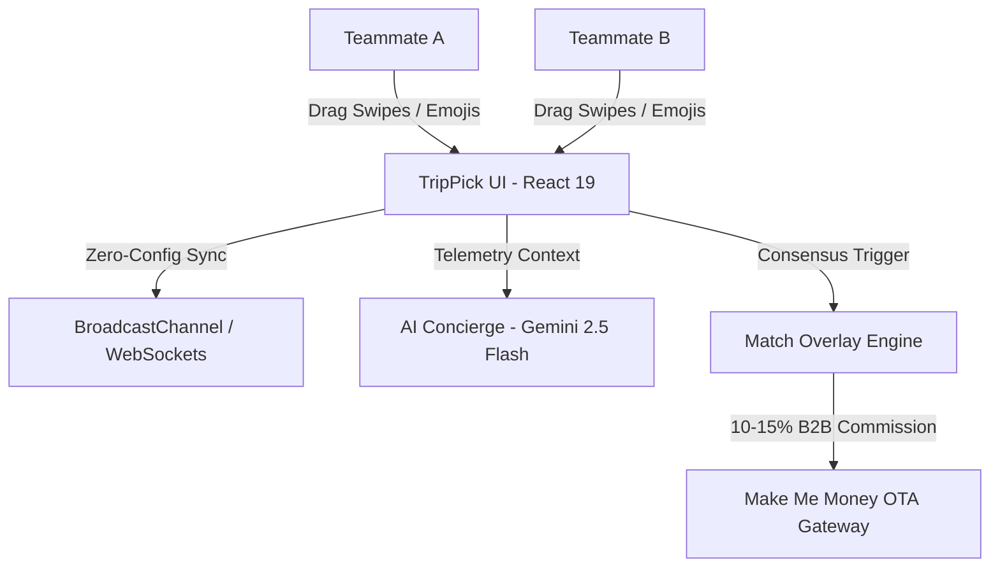

# TripPick — Corporate Retreats & Group Tourism Consensus Engine
### *Software for Business & Tourism (Web/App) : Make Me Money*

[](https://react.dev)
[](https://vitejs.dev)
[](https://tailwindcss.com)
[](LICENSE)

---

## 🧭 Executive Summary

**TripPick** transforms the chaotic, frustrating process of planning corporate retreats, MICE conferences, and group vacations into a gamified, real-time consensus engine. 

Instead of 3 weeks of deadlocked Slack or WhatsApp debates comparing spreadsheets and hotel tabs, team members join a 4-letter room code (e.g. `TRIP`), filter by verified business amenities (Starlink WiFi, executive boardrooms, private chefs), and swipe together Tinder-style. When teammates match on a destination, TripPick locks in the choice and monetizes high-ticket B2B bookings through instant affiliate OTA integration, corporate proposal generation, and sponsored partner decks.

---

## 🏆 Alignment with Contest Criteria (100 คะแนน)

### 1. ความสำคัญและความเข้าใจปัญหา (20 คะแนน)
- **The Problem**: 78% of group travel plans and corporate offsites get abandoned or delayed due to decision fatigue. Companies waste 15+ billable hours per trip comparing venues, negotiating dates, and arguing over budgets.
- **Target Audience**: 
  - Remote and hybrid tech companies planning annual offsites & hackathons (6–40 people).
  - Corporate travel managers and MICE event organizers.
  - Digital nomad squads and high-budget friend/family groups.
- **Revenue Concept**: Directly captures high-ticket commissions on completed retreats rather than low-margin individual clicks.

### 2. ความสมบูรณ์ของผลงาน (30 คะแนน)
- **Real-Time Cross-Device & Multi-Tab Consensus**:
  - 4-letter instant lobby code or 1-click shareable URL (`?room=TRIP`).
  - Seamless zero-config synchronization using `BroadcastChannel` for multi-tab testing, with Supabase Realtime support for cloud deployment.
- **Tactile Swiper Deck (Framer Motion 12)**:
  - High-res resort & villa photography with smooth physics drag gestures.
  - Verified business telemetry badges: Starlink WiFi speeds (Mbps), boardroom capacity, per-person rates.
  - Real-time teammate broadcast emojis (`🔥`, `🌴`, `💼`, `🥂`, `🚀`) and veto protection.
- **Context-Aware AI Concierge**:
  - Collapsible side drawer with live screen telemetry.
  - Responds to budget questions, per-person breakdowns, meeting room capacity, and team-building excursions.
  - Works 100% offline via local heuristics, with Google Gemini 2.5 Flash / DeepSeek / GPT-4o support.
- **Match Celebration & Instant Group Actions**:
  - Dynamic celebration overlay when consensus is reached.
  - Interactive per-person group expense calculator.
  - One-click Agoda/Booking.com B2B booking affiliate links.
  - One-click corporate RFP proposal export.

### 3. ความเป็นไปได้และผลกระทบ (Make Me Money — 30 คะแนน)
TripPick operates on a **high-ticket, multi-stream revenue model**:
1. **B2B Group OTA Commission (10% - 15%)**:
   - Average corporate retreat: 12 attendees × 3 nights × $180/night = **$6,480 Gross Booking Value (GBV)**.
   - At a 12% affiliate commission take rate via Agoda/Booking.com Partner APIs = **$777.60 net revenue per match**.
2. **Sponsored Destination Decks**:
   - Boutique luxury resorts and MICE convention hotels pay a monthly subscription ($399–$999/month) to appear as "Sponsored Priority Picks" in high-spend corporate lobbies.
3. **TripPick Enterprise SaaS Tier ($49/month per company)**:
   - Unlimited private lobbies, single sign-on (SSO), automated per-diem budget limits, corporate invoice consolidation, and company expense reporting.
- **Scalability**: Zero physical inventory risk; ultra-lightweight operational overhead.

### 4. การนำเสนอและตอบคำถาม (20 คะแนน)
- Full 2-minute video pitch script included below (in both Thai and English).
- Live interactive demo mode built into the app ("Instant Match Demo" button for 1-click evaluation).

---

## 🎬 2-Minute Video Pitch Script (สคริปต์นำเสนอผลงาน 2 นาที)

### [THAI VERSION]
- **0:00 - 0:25 (ปัญหา):** "เคยไหมครับ? เวลาบริษัทหรือกลุ่มเพื่อนจะจัดทริปไปเที่ยวหรือจัด Company Offsite สิ่งที่เกิดขึ้นคือเถียงกันใน Slack หรือ LINE เป็นอาทิตย์ คนนึงอยากได้ทะเล คนนึงอยากได้ภูเขา คนนึงกังวลเรื่องเน็ตช้า สุดท้ายแผนล่ม! สถิติพบว่า 78% ของกรุ๊ปทริปถูกยกเลิกเพราะหาข้อสรุปไม่ได้"
- **0:25 - 0:55 (การสาธิตผลงาน):** "นี่คือ **TripPick** แพลตฟอร์ม Consensus Engine สำหรับ Business & Tourism เพียงแค่ Host เปิดห้องด้วยรหัส 4 ตัว ทุกคนในทีมกดเข้าห้องผ่านมือถือ เลือกว่าต้องการเน็ต Starlink มีห้องประชุม หรืออาหารแบบ Private Chef จากนั้นเริ่ม 'ปัดขวา' เหมือน Tinder ไปพร้อมกันแบบ Real-time พร้อมผู้ช่วย AI Concierge ที่คอยตอบคำถามเรื่องงบและสเปกสถานที่ได้ทันที"
- **0:55 - 1:30 (โมเดล Make Me Money):** "และเมื่อทุกคนในทีมปัดถูกใจตรงกัน... เกิด **Match!** ระบบจะคำนวณงบประมาณต่อคน และดึงลิงก์จองตรงผ่านพาร์ทเนอร์ OTA ทันที ทริป Offsite ขนาด 10-15 คน มียอดจองเฉลี่ย 200,000 - 300,000 บาท TripPick สร้างรายได้จากคอมมิชชั่น B2B 10-15% นั่นคือ **20,000 - 45,000 บาท ต่อหนึ่งการ Match!** นอกจากนี้ยังมีรายได้จากโรงแรมที่จ่ายค่า Sponsored Pin และแพ็กเกจ Enterprise SaaS สำหรับองค์กร"
- **1:30 - 2:00 (สรุป):** "TripPick ไม่ใช่แค่แอปจองโรงแรม แต่เป็นเครื่องมือปิดการขายที่เปลี่ยนความลังเลให้กลายเป็นการจองจริงที่สร้างกำไรมหาศาล... TripPick: ปัด จบ จอง รับเงิน ขอบคุณครับ"

---

## 🛠️ Architecture & Tech Stack



- **Frontend**: React 19, TypeScript, Vite 8.
- **Styling**: Tailwind CSS v4, custom glassmorphism, fluid glowing background blobs.
- **Animations & Physics**: Framer Motion 12.
- **Synchronization**: Dual engine — `BroadcastChannel` (for instant local/offline multi-tab testing) and Supabase Realtime (for cloud production).
- **AI Intelligence**: OpenRouter / Google Gemini API with robust offline heuristic fallback.

---

## 🚀 Quickstart Guide

### 1. Install & Run Locally
```bash
# Clone the repository
git clone <your-repo-url>
cd trippick

# Install dependencies
npm install

# Start development server
npm run dev
```

Visit `http://localhost:5173` in your browser.

### 2. Multi-Tab Testing
1. Open `http://localhost:5173` in **Tab 1** and click **"Create New Team Retreat Room"**.
2. Complete your profile (e.g., "Sarah - Tech Lead") and copy the 4-letter room code (e.g., `TRIP`).
3. Open `http://localhost:5173` in **Tab 2** (or in an incognito window), enter the code `TRIP`, and join as "Alex - Product Lead".
4. Notice both team members appear live in the lobby!
5. In Tab 1, click **"Start Consensus Swiping Deck"**. Both tabs immediately enter swiping mode!
6. Swipe right on the same retreat card in both tabs — instant **"It's an Offsite Match!"** celebration triggers across both devices!

---

## 📄 License
MIT © 2026 TripPick Team.
